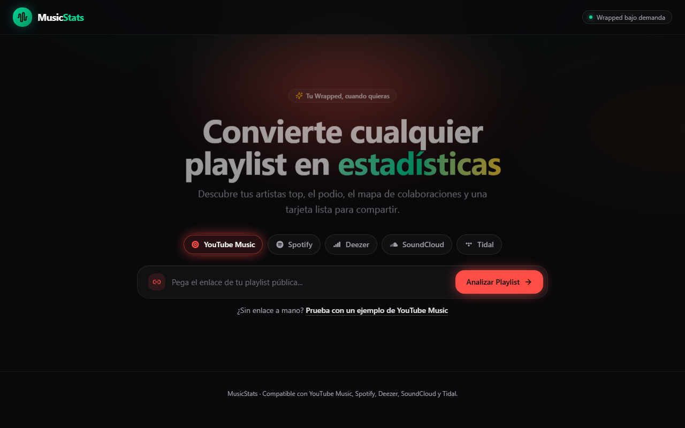

# 🎵 MusicStats

> **Tu Wrapped, cuando quieras.** Convierte cualquier playlist en estadísticas interactivas, podios de artistas y mapas de colaboración en segundos.

[](https://musicstats-app.vercel.app/)
[](https://nextjs.org/)
[](https://www.typescriptlang.org/)
[](https://tailwindcss.com/)
[](https://vitest.dev/)

---

## 🌐 Demo en vivo

👉 **[https://musicstats-app.vercel.app/](https://musicstats-app.vercel.app/)**

---

## 📸 Vista previa



---

## 🚀 Características principales

- **Multiplataforma sin fricción:** Compatible con **Spotify**, **YouTube Music**, **Deezer**, **SoundCloud** y **Tidal**. Analiza cualquier playlist pública al instante, sin requerir inicios de sesión obligatorios ni permisos invasivos.
- **🏆 Podio Top 3:** Visualización interactiva estilo podio de los artistas más repetidos, con avatares reales, canciones destacadas y desglose de apariciones.
- **🕸️ Mapa de Colaboraciones:** Grafo interactivo ("Quién canta con quién") que mapea las relaciones de featurings entre los artistas de tu playlist.
- **📊 Estadísticas Avanzadas:** Métricas de diversidad musical, canciones totales, artistas únicos, promedio de temas por autor y porcentaje de colaboraciones.
- **🎴 Tarjeta Compartible (Story Card):** Generación de tarjeta exportable optimizada para historias y redes sociales, con soporte para compartir mediante enlaces codificados sin necesidad de base de datos.
- **🧠 Normalizador Inteligente:** Algoritmo de parsing robusto que respeta bandas icónicas en español ("Patricio Rey y sus Redonditos de Ricota") y títulos compuestos ("Toco Y Me Voy"), evitando falsos colaboradores.

---

## 🛠️ Stack Tecnológico

- **Framework:** [Next.js 15](https://nextjs.org/) (App Router, React 19)
- **Lenguaje:** [TypeScript](https://www.typescriptlang.org/)
- **Estilos:** [Tailwind CSS 4](https://tailwindcss.com/)
- **Animaciones:** [Framer Motion](https://www.framer.com/motion/)
- **Iconografía:** [Lucide React](https://lucide.dev/)
- **Testing:** [Vitest](https://vitest.dev/) (174 pruebas unitarias de extractores, normalizadores y adaptadores)
- **Despliegue:** [Vercel](https://vercel.com/)

---

## 💻 Instalación y Desarrollo Local

1. **Clonar el repositorio:**
   ```bash
   git clone https://github.com/DanielPalermoo/musicStats.git
   cd musicStats
   ```

2. **Instalar dependencias:**
   ```bash
   npm install
   ```

3. **Iniciar el servidor de desarrollo:**
   ```bash
   npm run dev
   ```
   Abre [http://localhost:3000](http://localhost:3000) en tu navegador.

4. **Ejecutar la suite de pruebas:**
   ```bash
   npm test
   ```

5. **Construir para producción:**
   ```bash
   npm run build
   ```

---

## 🔑 Variables de Entorno (Opcional)

MusicStats funciona por defecto con los extractores públicos de respaldo. Para mayor estabilidad con playlists extensas de Spotify, puedes configurar tus credenciales en un archivo `.env.local`:

```env
SPOTIFY_CLIENT_ID=tu_client_id_aqui
SPOTIFY_CLIENT_SECRET=tu_client_secret_aqui
```

---

## 📄 Licencia

Este proyecto está bajo la licencia MIT.
